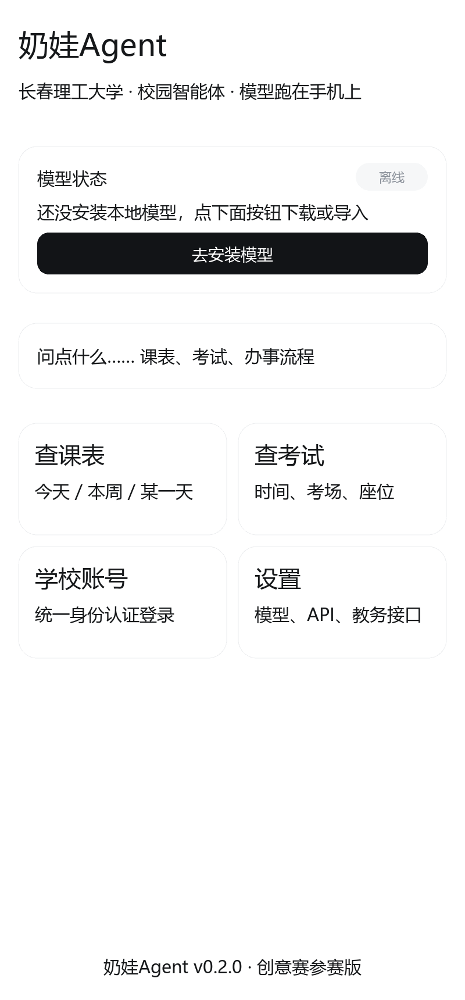
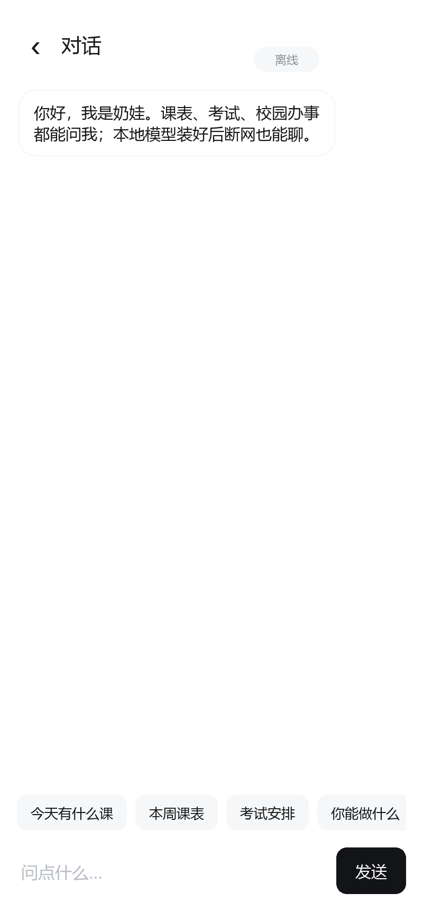
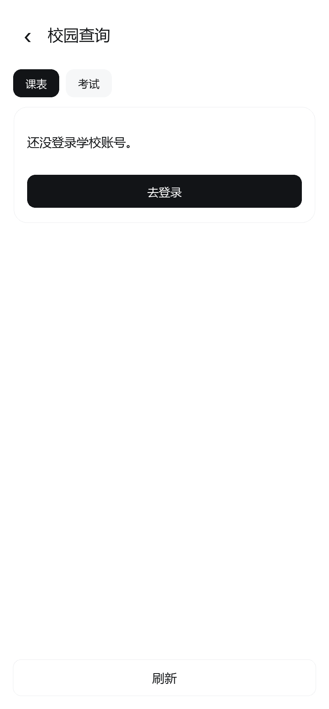
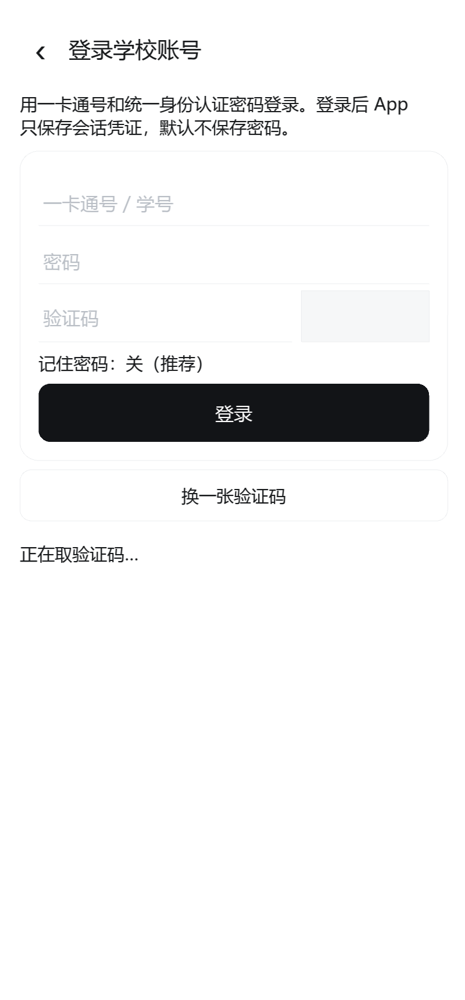
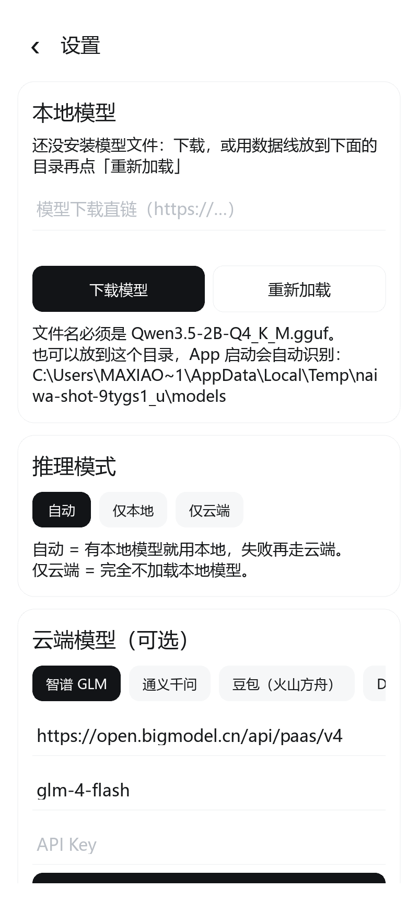

# 奶娃 Agent · Naiwa Agent

> 长春理工大学校园智能体 —— 本地大模型在手机上跑，课表 / 考试 / 校园问答不出设备。

「奶娃 Agent」是一个 **纯 Python + Kivy** 的 Android 智能体应用：

- **端侧推理**：内置 `Qwen3.5-2B-Q4_K_M.gguf`，通过 llama.cpp 在手机本地运行，断网可用、对话不出手机。
- **云端兜底**：保留 OpenAI 兼容接口（智谱 / 通义 / 豆包 / 自建），在本地模型不可用或需要更强能力时一键切换。
- **校园打通**：接入长春理工大学统一身份认证（CAS），登录后可直接查课表、查考试安排。
- **纯白界面**：无第三方 UI 框架，全部控件用 Kivy 原生 canvas 手绘，白底、细线、单一强调色。

---

## 一、系统支持

| 项目 | 值 |
|---|---|
| 最低版本 | **Android 13（API 33）** |
| 已适配 | Android 13 / 14 / 15 / 16 / 17（API 33–37） |
| 架构 | arm64-v8a（2019 年后的机器基本都覆盖） |
| compileSdk / targetSdk | 36（要跟到 37 就改 `buildozer.spec` 的 `android.api`） |
| 权限 | 仅 `INTERNET`、`ACCESS_NETWORK_STATE` |

跨版本已经处理掉的三件事：

- **Android 15+ 强制 edge-to-edge** → `naiwa/platform_compat.py` 用 jnius 读真实系统栏高度，
  界面自己让出安全区，标题不会被状态栏压住；读不到就退化为 0，不崩。
- **Android 16 起 16 KB 内存页** → `scripts/build_llama_android.sh` 用
  `-Wl,-z,max-page-size=16384` 链接所有原生库，否则装上新机会直接闪退。
- **Android 13 起分区存储** → 不再申请读写外部存储、也不去 `/sdcard/Download` 找模型，
  只用 App 私有目录和它自己的 `Android/data/<包名>/files`（两者都不需要权限）。

## 二、界面预览

真机渲染由 `tests/ui_screenshot.py` 生成（纯白 + 细描边 + 近黑强调色，无第三方 UI 库）：

| 首页 | 对话 |
|---|---|
|  |  |

| 校园查询 | 登录 | 设置 |
|---|---|---|
|  |  |  |

## 三、这个仓库怎么变成 APK

提交后由 **GitHub Actions** 自动构建，不需要本地装 Android SDK。

1. 把仓库推到 GitHub（`main` 分支）。
2. 打开 `Actions → Android APK → Run workflow`（push 也会自动触发）。
3. 构建完成后在该次运行页面底部下载 `naiwa-agent-debug-apk`，得到 `naiwa-0.2.0-arm64-v8a-debug.apk`。
4. 传到手机安装（需要允许「安装未知来源应用」）。

> 首次构建约 30–45 分钟（要下载 Android SDK / NDK 25b 并编译依赖），之后有缓存约 10 分钟。

## 四、模型怎么进手机

GitHub 不能把 1.19 GB 的 GGUF 塞进 APK（会超出大小限制、也会让安装变慢），所以模型是**首次启动时下载**或**手动导入**：

- **下载**：设置 → 本地模型 → 填入模型直链（建议放你自己的 GitHub Release 或国内对象存储）→ 开始下载。
- **导入**：把 `Qwen3.5-2B-Q4_K_M.gguf` 放到手机
  `Android/data/com.naiwa.naiwaagent/files/models/` 目录下，App 启动会自动识别。
- 模型存放路径在 App 私有目录，卸载 App 会一起删除。

## 五、本地开发

```bash
python -m venv .venv
. .venv/Scripts/activate        # Windows
pip install kivy                # 桌面调试只装 Kivy 即可
python main.py
```

桌面模式下没有 `libllama`，App 会自动降级到「API 模式」，界面和逻辑都能完整调试。

跑测试（不依赖 Kivy，纯标准库）：

```bash
python -m unittest discover -s tests -v
```

## 六、目录结构

```
main.py                 入口，装配 App
naiwa/
  config.py             常量、路径解析（Android 私有目录 / 桌面）
  platform_compat.py    Android 13–17 兼容层（edge-to-edge 安全区、状态栏图标）
  secure.py             轻量加密存储（HMAC-SHA256 派生密钥流 + 认证标签）
  store.py              设置、会话、对话记录
  llm/
    base.py             Message / Provider 抽象
    local_gguf.py       本地 GGUF 推理（llama-cpp-python 优先，ctypes 兜底）
    remote.py           OpenAI 兼容流式接口
    router.py           本地优先 → 云端兜底 → 模板兜底
    prompt.py           人设与系统提示词
  agent/
    intents.py          规则意图识别（小模型不适合做 function calling）
    tools.py            工具注册表（课表 / 考试 / 成绩 / 时间）
    runtime.py          智能体主循环
    memory.py           会话记忆
  campus/
    cas.py              CAS 登录（含验证码、票据校验、Cookie 会话）
    portal.py           教务数据适配器（课表 / 考试）
    models.py           Course / Exam
  ui/                   纯白界面
buildozer.spec          Android 打包配置
.github/workflows/      GitHub Actions
docs/                   作品说明文档、技术方案、CAS 接入说明
scripts/                模型下载、接口探测辅助脚本
```

## 七、合规说明

按赛事要求：全部开发、调试、模型调用仅使用国内合规模型与国内平台。本项目默认模型为 Qwen 系列开源权重（本地推理），API 接入仅列举国内厂商，未包含任何境外服务。

## 八、当前已知限制

见 `docs/技术方案.md` 的「已知限制」一节。最关键的一条：**教务数据接口需要你用自己的账号抓一次包**，
把地址填进 App 的「设置 → 教务接口」（或改 `naiwa/campus/portal.py` 的字段别名表），
因为学校门户的接口路径没有公开文档。
